# 📬 Awesome-Mail-Merge

  
  
  
  
  
  

  

  <strong>Curated directory of SaaS products and open-source GitHub projects for mail merge, personalized bulk email, Gmail campaigns, cold email outreach, and document generation.</strong>

---

## 📑 Table of Contents

- [🔍 Overview](#-overview)
- [📊 Sector Overview & Market Dynamics](#-sector-overview--market-dynamics)
- [🏢 SaaS & Hosted Platforms](#-saas--hosted-platforms)
- [💻 Open-Source GitHub Projects](#-open-source-github-projects)
- [🛠️ Architectural Stacks & Recipes](#️-architectural-stacks--recipes)
- [🤝 How to Contribute](#-how-to-contribute)
- [💖 Support](#-support)
- [⭐ Star History](#-star-history)
- [⚖️ Disclaimer](#️-disclaimer)

---

## 🔍 Overview

**Mail Merge** is the backbone of modern personalized communications, document generation, and direct outreach. Whether combining spreadsheet-driven contact lists with template variables in Google Workspace, dispatching scheduled cold outreach campaigns with inbox rotation, or programmatically filling Word (`.docx`) and PDF certificates, this repository tracks both industry-leading SaaS platforms and actively maintained open-source repositories.

### 🎯 Key Focus Areas:
- ✉️ **Personalized Bulk Email**: Dynamic placeholders (`{{first_name}}`, `{{company}}`), conditional formatting, and multi-field tags.
- 🌐 **Gmail & Workspace Integration**: Google Sheets data sources, drafts templating, daily sending cap optimization, and native add-ons.
- 🚀 **Cold Outreach & Sales Automation**: Multi-stage drip sequences, inbox rotation, automated follow-ups, and engagement tracking.
- 📄 **Document Generation**: Programmatic Word (`.docx`), PDF, and LibreOffice document generation from structured CSV/Excel inputs.

---

## 📊 Sector Overview & Market Dynamics

The broader **Sales Engagement Platform (SEP) and Outbound Email Automation** software sector represents an estimated market size of **$3.89 billion to $9.20 billion** (projected to reach over $26 billion into the early 2030s at a CAGR of 10.8% to 17.3%), with dedicated cold email outreach and mail merge tooling capturing a specialized **~$1.8 billion** segment. 

The sector is **highly fragmented** rather than winner-take-all. Despite heavy presence from broader enterprise sales engagement platforms, hundreds of thousands of sales representatives, recruiters, founders, and educators rely on lightweight, modular point solutions. This fragmentation is driven by diverse deployment preferences—ranging from zero-telemetry local-first Gmail senders and Google Workspace marketplace add-ons to self-hosted SMTP relays and full-cycle B2B SDR automation engines. While recent market cycles have spurred bundling and consolidation, specialized mail-merge engines and developer libraries continue to thrive due to API flexibility, privacy considerations, and cost advantages over seat-based SaaS tiers.

---

## 🏢 SaaS & Hosted Platforms

The following market-leading SaaS mail-merge and cold outreach platforms are ranked in descending order by **Company Size / Estimated Annual Recurring Revenue (ARR) / Corporate Valuation**:

| 🚀 Platform | 🏢 Company Size / Revenue / Valuation | 💳 Starting Tier Pricing | 🎁 Free Tier / Trial Limit | 🌟 Key Capabilities & Differentiators |
|:---|:---|:---|:---|:---|
| **[Yet Another Mail Merge (YAMM)](https://yamm.com/)** | **~$60.0M Group ARR** (~$10M+ Workspace Suite) • Bootstrapped (Talarian) • ~40 team members | **$25.00/year** (~$2.08/mo) for Personal plan (up to 400 emails/day); **$50.00/year** for Professional (1,500 emails/day) | **Free Forever plan**: 50 emails/24 hrs with Google Sheets integration, personalized merge tags, and open/click tracking | Flagship Google Sheets add-on for Gmail campaigns. Merges spreadsheet data directly with Gmail drafts, per-recipient status columns, and auto-scheduling. |
| **[Mixmax](https://mixmax.com/)** | **~$13.0M – $17.6M ARR** • Valuation ~$60M+ • $13.4M–$22M Venture Funded (Creandum, Harrison Metal) | **$29.00/user/month** (billed annually) or $34/user/mo (monthly) for SMB Starter plan | **14-day free trial** (unlimited features, no credit card required) + **Free Forever tier** with 100 email tracking alerts/mo and instant scheduling | Full-cycle sales engagement suite embedded in Gmail. Features multi-stage sequences, CRM auto-sync, customizable email templates, and interactive polls. |
| **[Saleshandy](https://saleshandy.com/)** | **~$8.0M – $15.3M ARR** • Bootstrapped • ~109 employees | **$25.00/month** (billed annually) or $36.00/mo (monthly) for Outreach Starter (2,000 active leads, 10,000 emails/mo) | **7-day free trial** with 200 email credits and 1 connected email account (no credit card required) | Cold outreach engine featuring unified inbox rotation, automated follow-up sequences, deliverability warmup, and CRM integration. |
| **[Woodpecker.co](https://woodpecker.co/)** | **~$5.0M – $11.6M ARR** • **Public (WSE NewConnect: WPR)** • Market Cap ~$3.8M – $13.6M USD | **$29.00/month** (or $25.00/mo billed annually) for Cold Email Starter (500 contacted prospects/mo) | **7-day free trial** with 50 contacted prospects / 50 email sends and full delivery monitoring (no credit card required) | Dedicated B2B cold email deliverability platform with condition-based sequences, automated warmup, human-like sending intervals, and spam detection. |
| **[GMass](https://www.gmass.co/)** | **~$5.4M ARR** (~$450K MRR) • Bootstrapped by Ajay Goel • ~300K+ active accounts | **$25.00/month** (or $225/year, ~$18.75/mo) for Standard plan (unlimited contacts, auto follow-ups) | **Free Forever plan**: 50 emails/day with complete mail merge tags, sequence automation, and open/click analytics | Powerhouse mass mailing extension directly inside Gmail. Features automated drip campaigns, list segmentation, A/B testing, and custom SMTP integration. |
| **[Streak](https://www.streak.com/)** | **~$3.7M – $5.0M ARR** • $1.9M Funded (Y Combinator) • ~34 employees • 750K+ users | **$49.00/user/month** (billed annually) or $59.00/user/mo (monthly) for Pro plan ($15/mo for Solo plan) | **Free Forever plan**: 500 CRM boxes/records, 50 mail merge emails/day, basic view tracking, and 14-day Pro trial access | Fully native CRM built inside Gmail inbox. Combines visual deal pipelines, contact merge, snippets, open tracking, and shared team threads. |
| **[QuickMail](https://quickmail.io/)** | **~$2.8M ARR** • Bootstrapped by Jeremy Chatelaine • ~25 employees | **$49.00/month** for Basic Plan (30,000 emails/mo, 10 inbox seats) | **14-day free trial** with 3,000 sending credits and full multichannel sequence access (no credit card required) | High-deliverability cold email tool built for agencies and SDR teams with automatic inbox rotation, deliverability warmup, and team collaboration. |
| **[Mailmeteor](https://mailmeteor.com/)** | **~$770K – $2.0M ARR** • Bootstrapped • 5M+ users • ~7 employees | **$9.99/month** (or $49.99/year, ~$4.17/mo) for Premium plan (500 emails/day) | **Free Forever plan**: 50 emails/day with Google Sheets merge, personalized template tags, and delivery tracking | Privacy-focused Gmail mail merge extension requested by millions. Operates with minimal permissions, spam filter safeguards, and instant CSV imports. |
| **[Mergo](https://mergo.co/)** | **~$1.0M+ Product ARR** (Talarian Group ~$60M ARR) • Bootstrapped • 3M+ installs | **$1.50/month** ($18.00/year) for Personal (500 emails/day); **$4.00/month** ($48.00/year) for Professional | **Free Forever plan**: 30 emails/day with email tracking, scheduling, and personalized merge variables | Clean Google Sheets & Gmail merge add-on built by Romain Vialard. Supports recurring campaigns, personalized attachments, and automated reply tracking. |
| **[Vocus.io](https://vocus.io/)** | **~$300K – $700K ARR** • Bootstrapped Micro-SaaS • 1–3 employees | **$5.00/month** for Basic plan (200 tracked emails/day); **$10.00/month** for Starter | **30-day free trial** with 100 emails/day limit and full feature access (no credit card required) | Lightweight Gmail outreach extension providing automated multi-step drip campaigns, open/click notifications, calendar scheduling, and mail merge. |

---

## 💻 Open-Source GitHub Projects

Explore verified open-source mail-merge libraries, command-line clients, web tools, and document generation utilities. **Ranked in descending order by GitHub Stars**:

| 📦 Repository & Project | 🌟 Stars | 🛠️ Language / Stack | 📖 Description & Capabilities |
|:---|:---:|:---|:---|
| **[senny/sablon](https://github.com/senny/sablon)** |  | `Ruby` | Document template processor based on `.docx` templates and mail merge fields. Supports conditional sections, loops, image insertion, and clean templating. |
| **[berteh/ScribusGenerator](https://github.com/berteh/ScribusGenerator)** |  | `Python` | Generates high-quality vector PDFs and desktop publishing documents dynamically from spreadsheet (CSV) data via Scribus templates. |
| **[Bouke/docx-mailmerge](https://github.com/Bouke/docx-mailmerge)** |  | `Python` | Pure Python library for performing mail merge on Office Open XML (`.docx`) files without requiring Microsoft Word installed. |
| **[awdeorio/mailmerge](https://github.com/awdeorio/mailmerge)** |  | `Python` / `CLI` | Simple, powerful command-line mail merge tool in Python using Jinja2 templates, CSV contact data, and standard SMTP server delivery. |
| **[mmonterroca/docxgo](https://github.com/mmonterroca/docxgo)** |  | `Go` | Create and manipulate Microsoft Word (`.docx`) documents in pure Go with a fluent builder API, templates, mail merge fields, tables, and images. |
| **[axuno/MailMergeLib](https://github.com/axuno/MailMergeLib)** |  | `C#` / `.NET` | Comprehensive .NET SMTP client library providing high-throughput mail merge, inline images, attachments, asynchronous delivery, and fault-tolerant sending. |
| **[nakov/Smart-Mass-Mailer](https://github.com/nakov/Smart-Mass-Mailer)** |  | `C#` / `.NET` | Bulk email sender with mail merge, HTML templates, customizable delay intervals between dispatches, attachments, and multi-threaded sending. |
| **[labnol/email-studio-gmail-addon](https://github.com/labnol/email-studio-gmail-addon)** |  | `JavaScript` / `GAS` | Gmail add-on by Amit Agarwal (Digital Inspiration) providing mail merge, scheduled email dispatches, forwarders, auto-responders, and draft automation. |
| **[iulica/docx-mailmerge](https://github.com/iulica/docx-mailmerge)** |  | `Python` | Modernized fork of `docx-mailmerge` for Python 3.7+ with table row merging, anchor fields, format switches (Date, Numeric, Text), and page/section breaks. |
| **[nickvidal/mailsheet](https://github.com/nickvidal/mailsheet)** |  | `JavaScript` / `GAS` | Lightweight script to send personalized bulk emails directly from Google Sheets using custom column merge variables. |
| **[LibreOffice/lots](https://github.com/LibreOffice/lots)** |  | `Python` / `StarBasic` | LibreOffice extension for letterheads, templates, forms, autotext, and automated batch mail merge document rendering. |
| **[kumo/sketch-mail-merge](https://github.com/kumo/sketch-mail-merge)** |  | `JavaScript` / `Sketch` | Sketch design plugin to populate design mockups and artboards by merging real CSV tabular records into text layers and image assets. |
| **[harshjv/gmail-mail-merge](https://github.com/harshjv/gmail-mail-merge)** |  | `JavaScript` / `GAS` | Clean, open Google Script for performing mail merges using Google Spreadsheets and Gmail drafts with quota safeguards. |
| **[andrie/mailmerge](https://github.com/andrie/mailmerge)** |  | `R` | R package for performing mail merges using R Markdown documents, parameterized templates, and the `gmailr` package. |
| **[ttsukagoshi/mail-merge-for-gmail](https://github.com/ttsukagoshi/mail-merge-for-gmail)** |  | `JavaScript` / `GAS` | Google Workspace Add-on for Gmail mail merge with Group Merge to combine multiple table rows into single itemized receipts per recipient. |
| **[swxben/docx-template-engine](https://github.com/swxben/docx-template-engine)** |  | `C#` / `.NET` | Template engine for .NET that takes a `.docx` file and binds data objects to generate customized reports, invoices, and mail merges. |
| **[martineausimon/nvim-mail-merge](https://github.com/martineausimon/nvim-mail-merge)** |  | `Lua` / `Vim` | NeoVim plugin for developers wanting a streamlined mail merge workflow directly inside their terminal text editor. |
| **[riteshkarmakar/bulk-email-sender](https://github.com/riteshkarmakar/bulk-email-sender)** |  | `Python` / `Tkinter` | Python desktop GUI application for sending personalized emails in bulk with dynamic placeholders, file attachments, and SMTP support. |
| **[hochanh/pdf-mail-merger](https://github.com/hochanh/pdf-mail-merger)** |  | `Python` | PDF mail merger, editor, and generator from Excel/CSV files for batch creating personalized certificates, invoices, and letters. |
| **[Gauthi3r/tinymails](https://github.com/Gauthi3r/tinymails)** |  | `Node.js` | Local-first Gmail mail merge for small, permission-based outreach. Zero telemetry, OAuth scoped strictly to `gmail.send`, CSV deduplication, and local backups. |
| **[jfaccioli/documint](https://github.com/jfaccioli/documint)** |  | `Python` / `Flask` | Lightweight Flask web app for bulk personalized Word document generation from `.docx` templates and Excel spreadsheets. |
| **[spekulatius/linux-bash-mail-merge](https://github.com/spekulatius/linux-bash-mail-merge)** |  | `Shell` / `Bash` | Minimalist CLI bash helper to merge mail content based on CSV files and trigger sending via desktop browser mailto handlers. |

---

## 🛠️ Architectural Stacks & Recipes

Build customized, private, and cost-effective mail merge stacks:

1. **🔒 Privacy-First Local Gmail Merge**:
   - Engine: **[TinyMails](https://github.com/Gauthi3r/tinymails)** (Local-first, `gmail.send` scope only)
   - Data Source: Local `.csv` files
   - Advantage: No external cloud servers store contact emails, templates, or Google OAuth refresh tokens.

2. **📄 High-Speed Document & PDF Generation**:
   - Engine: **[docx-mailmerge](https://github.com/iulica/docx-mailmerge)** or **[sablon](https://github.com/senny/sablon)**
   - Exporter: LibreOffice headless mode or **[pdf-mail-merger](https://github.com/hochanh/pdf-mail-merger)**
   - Advantage: Generates hundreds of custom contracts, diplomas, or receipts per second without proprietary Microsoft Office dependencies.

3. **📊 Native Google Workspace Add-on**:
   - Engine: **[Group Merge](https://github.com/ttsukagoshi/mail-merge-for-gmail)** or **[Email Studio](https://github.com/labnol/email-studio-gmail-addon)**
   - Interface: Google Sheets UI with Apps Script triggers
   - Advantage: Seamless collaboration among non-technical team members directly inside Google Sheets and Gmail.

---

## 🤝 How to Contribute

Contributions are warmly welcomed! To suggest a new open-source repository or SaaS tool:

1. 🍴 **Fork the repository** on GitHub.
2. 🌿 **Create a descriptive feature branch** (`git checkout -b feature/add-new-mail-merge-tool`).
3. 📝 **Add your entry** to the appropriate section maintaining markdown formatting, alphabetical order or star ranking, verified starting tier pricing, and clear descriptions.
4. 📬 **Submit a Pull Request** with a brief summary of the project and why it belongs in this directory.

---

## 💖 Support

Thank you for exploring and utilizing **Awesome-Mail-Merge**!

If you find this repository valuable, please consider supporting its ongoing maintenance and curation:
- ⭐ **Star this repository** to improve visibility for the developer community.
- 🍴 **Fork and share** with colleagues, sales operations, and developers building communication pipelines.
- ☕ **Sponsor the Maintainer**: [GitHub Sponsor Dashboard](https://github.com/sponsors/ishandutta2007)

---

## ⭐ Star History

---

## ⚖️ Disclaimer

- This is an **independent, community-curated directory** for educational, engineering, and product comparison purposes.
- Users of mail merge, mass mailing, and outreach tooling are responsible for compliance with relevant laws and service terms, including **CAN-SPAM**, **GDPR**, **CASL**, and respective provider sending policies (e.g., Google Workspace sending quotas). Unsolicited bulk email can degrade domain deliverability and lead to account suspension.
